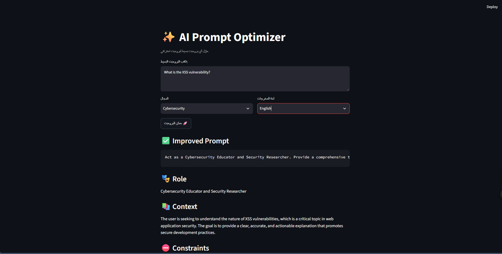
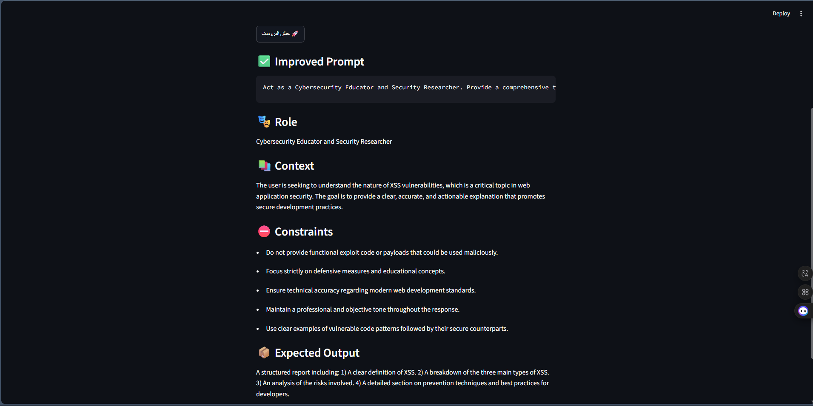

# 🚀 [Tips Hindawi](https://www.tipshindawi.com/) Internship (August–October) 2026

> 🎓 This project was built during the [ **Tips Hindawi** ](https://www.tipshindawi.com/) **Internship (August–October) 2026**.

## 👤 Participant

| Field            | Value                                |
| ---------------- | ------------------------------------ |
| Full Name        | Hossam Eldin Tarek Mamdouh           |
| Project Name     | AI Prompt Optimizer                  |
| GitHub Username  | ironfest002                          |
| Internship Batch | August–October 2026                  |
| Training Program | Large Language Models (LLMs) Program |
| Organization     | [**Edrak for Ai**](https://edrak4ai.com/en)                         |

---

# 📖 Project Overview

AI Prompt Optimizer turns a short, simple prompt into a professional, well-structured prompt that is ready to copy and use with any AI assistant.

The project sends the user's simple prompt to an LLM (Google Gemini) with expert prompt-engineering instructions, then parses the reply into five fixed fields: **Improved Prompt**, **Role**, **Context**, **Constraints**, and **Expected Output**. It is built as a simple pipeline: Prompt Template ➜ LLM ➜ Output Parser ➜ Streamlit UI.

---

# ✨ Features

* Converts any simple prompt into a professional prompt with one click.
* Structured output (Role, Context, Constraints, Expected Output) enforced with a Pydantic Output Parser.
* Domain selection: General, Marketing, Coding, Education, and Cybersecurity.
* Output language selection: English or Arabic.
* Simple Streamlit interface with a built-in copy button for the final prompt.

---

# 🛠️ Technologies Used

* Python
* LangChain (Prompt Template, Chain, Output Parser)
* Pydantic (`PydanticOutputParser`)
* Google Gemini API (`langchain-google-genai`)
* Streamlit
* python-dotenv

---

# ⚙️ Installation

1. Clone the repository:

```bash
git clone https://github.com/ironfest002/Tips-Hindawy-Project.git
cd prompt-optimizer
```

2. Create and activate a virtual environment:

```bash
# Windows (PowerShell)
python -m venv venv
.\venv\Scripts\Activate.ps1

# Linux / macOS
python3 -m venv venv
source venv/bin/activate
```

3. Install the dependencies:

```bash
python -m pip install -r requirements.txt
```

4. Get a free API key from [Google AI Studio](https://aistudio.google.com/apikey), then create your `.env` file from the example:

```bash
# Windows (PowerShell)
Copy-Item .env.example .env

# Linux / macOS
cp .env.example .env
```

5. Open `.env` and put your key inside it:

```
GOOGLE_API_KEY=your_api_key_here
```

> ⚠️ Never commit your real `.env` file. It is already listed in `.gitignore`.

---

# 🚀 Usage

Run the app:

```bash
python -m streamlit run app.py
```

Then open `http://localhost:8501` and:

1. Type a simple prompt, for example: `What is the XSS vulnerability?`
2. Choose the domain and the output language.
3. Click the improve button.
4. Copy the **Improved Prompt** and use it with your favorite AI assistant.

---

# 📸 Demo





---

# 📈 Results

For the input `What is the XSS vulnerability?` (domain: Cybersecurity), the tool produced:

* **Role:** Cybersecurity Educator and Security Researcher
* **Improved Prompt:** a detailed prompt covering how XSS works, its types (Stored, Reflected, DOM-based), its impact, and defensive practices such as input validation, output encoding, and Content Security Policy.
* **Constraints:** no functional exploit code, focus on defense, technical accuracy, and a professional tone.
* **Expected Output:** a structured report with a definition, the types, the risks, and prevention techniques.

The project delivers a working end-to-end LLM application with reliable structured output on every run.

---

# 🔮 Future Improvements

* Prompt history to review and reuse previous results.
* Prompt quality score with feedback on what is missing.
* Make the model name configurable from the `.env` file with a fallback model.

---

# 📚 About the Internship

This project was developed as part of the [**Tips Hindawi**](https://www.tipshindawi.com/) **Internship (August–October) 2026**, and it will be showcased on the official [Tips Hindawi](https://www.tipshindawi.com/) website.

[Tips Hindawi](https://www.tipshindawi.com/) is the internships department of [**Edrak for Ai**](https://edrak4ai.com/en), and the internship encourages participants to build real-world projects, apply practical skills, and showcase their work through GitHub.

For more information about the internship, training programs, and upcoming batches, visit the official [Tips Hindawi](https://www.tipshindawi.com/) website.

---

# 📄 License

This project is shared for educational and portfolio purposes.
